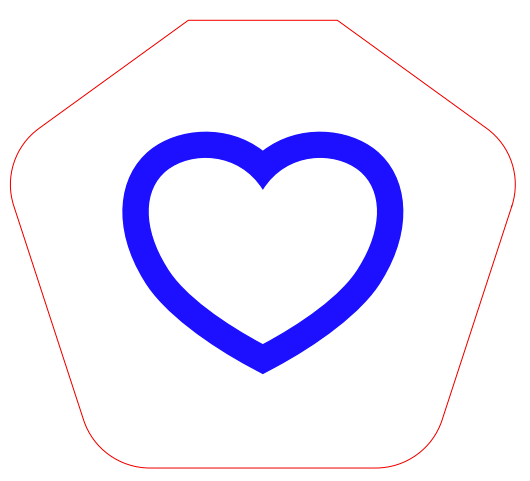

# Design Workshop A1 Variation - Mix 3D print & laser cut / engrave

Combine a 3d-printed casing with a laser cut lid in acrylic plastic

Quick and easy way to manufacture the lid during the workshop (much faster than 3d-printing). Also enable adding decoration by the participants and a easy 2D way to design

