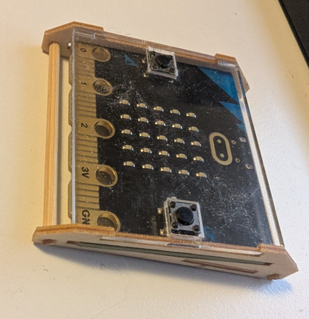

# Design Workshop

Combining both the casing design (laser or 3D-printed) with a programmed behaviour results in a product that can be worn on the wrist

---

**Concept for Microbit casing.**

- Controller: Microbit controller
- Casing: Lasercut plywood and plexi mounted with skewers.
- Battery: Two AAA fastened to the wrist fastener
- Basic wrist fastener: Old sock as elastic wrist band for first use

Draft
