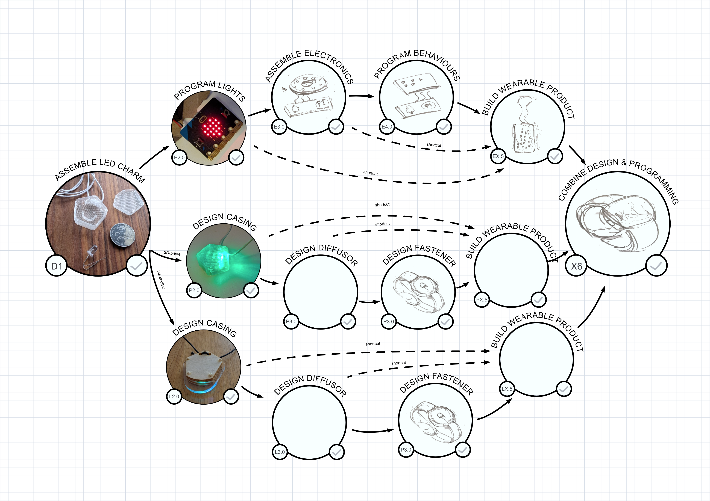

# Design Workshops - STEM + A

I believe that designing a wearable products can be one of the **best ways to introduce people to product design and technology (STEM)**. Therefore theese workshops have been created to play and learn in steps towards mastering product design.

The workshops starts with just assmebling a blinking RGB LED and a CR2032 battery with some tape in a small casing (A1) and then increasing in complexity.

The key aspects of designing a wearable product (light source, energy, control, casing, fastener, diffusor) has been separated into different workshop paths which can be taken in steps, mixed around and combined at the end.

It's a work in progress so feel free to contribute to the workshops or add variants.

---

### Workshops Overview

Target audience: 7-17 year old with little or no experience in design or electronics

Each workshop requires some preparations by a supervisor with some basic experience in how to operate a 3D-printer/laser cutter and electronics.

Focus areas: Geometry, Electronics, Optics, Manufacturing 

| Category | Explore | Productify | Status |
| -------- | -------- | -------- | -------- |
| Start | [A1 - Assembly your first wearable](A1_Assemble_LED_charm/readme.md) | - |  Ready |
| 3D-print | [P2.0 - Design 3D-printed casing](P2.0_Design_3D-printed_casing/readme.md) | P2.5 - Productify 3D-printed casing |  Ready |
| 3D-print | P3.0 - Design 3D-printed diffusor | P3.5 - Productify diffusor |  WIP |
| 3D-print | [P4.0 - Design 3D-printed fastener](P4.0_Design_3D-printed_fastener/readme.md) | P4.5 - Productify fastener | WIP |
| Lasercut | [L2.0 - Design lasercut casing](L2.0_Design_lasercut_casing/readme.md)   | L2.5 - Productify casing   | draft |
| Lasercut | L3.0 - Design lasercut diffusor | P3.5 - Productify diffusor | - |
| Lasercut | L4.0 - Design lasercut fastener | L4.5 - Productify fastener | - |
| Electronics | [E2.0 - Program LED](E2.0_Program_LED/readme.md) | [E2.5 - Productify LED](E2.5_Productify_LED/readme.md) | draft |
| Electronics | E3.0 - Assemble Electronics | E3.5 - Productify Assembled Electronics | - |
| Electronics | E4.0 - Program Behaviours | E4.5 - Productify Behaviours | - |
| Final | X6 - Combine Casing and Electronics | X6.5 - Productify | - |

---

### Workshop outline

Depending on the background of the participants there are two ways to start (left side) the journey towards mastering product design of a Wearable. Then combine the knowledge to design full products (right side)

- **D: Casing & fastener design** - Focus on the casing design and how to mount it to a person (string, clip, wristband, etc). Choose 3D printed or laser cut path depending on what equipment you intend to use (unless fully digital design workshops). The basic blinking LED can be kept throught all the steps.

- **E: Programming & electronics** - Focus on how to control the behaviour of the light and the electronics. The basic string necklace approach can be kept through all the steps.

---

### The product design process

The role of the designer is to **keep asking the right questions** to consider all the different aspects about the product to be designed. 

When doing something you have never done before you need to take it in small steps and iterate on each new result and idea. This requires a lot of practice for product design since there are many paths to consider and most wont lead to a good product. 

> Designing a product is keeping 5,000 things in your brain, these concepts, and fitting them all together in kind of continuing to push to fit them together in new and different ways to get what you want. - Steve Jobs, Apple

---

### Six questions to be askin for wearables

(I) How should the product appear to the user (shape, color, behaviour)?

(II) How should the light, battery and controller stay together?

(III) How should the user wear the product, including taking it on / off?

(IV) How should the user turn the product on / off

(V) How should the product be manufactured?

(VI) How should the product be assembled?

> For a real product you also need to include: What is the total cost of the product (material, manufacturing, assembly, handling, shipping, etc), and what happens to the product when it breaks down (repair, recycle)? But this can be ignored for these workshops

---

### Key concepts of a wearable product that emit light

**Light source:** Something that emits light can really help a wearable thing to be interesting. Start with a blinking LED RGB that just needs 3V to get going.

**Diffusor:** Design the way the light spread and appears to someone wathcing it. Start with a matte transparent plastic.

**Energy source:** Bring along a battery to make a wearable product easy to use. Start with a 3V CR2032 for small form factor and easy use.

**Casing:** Keep the battery, light source and diffusor together in one place. Start with a small hexagonal box with a lid (or similar)

**Fastener:** Make it possible for the user to wear the product on their body. Start with a string to use as a necklace.

**Controls:** Design the behaviour of the light. Start with a predetermined blinking or controling a single diode with a micro processor.

## Contribution guidelines

Test, play, feedback and add your own variants

